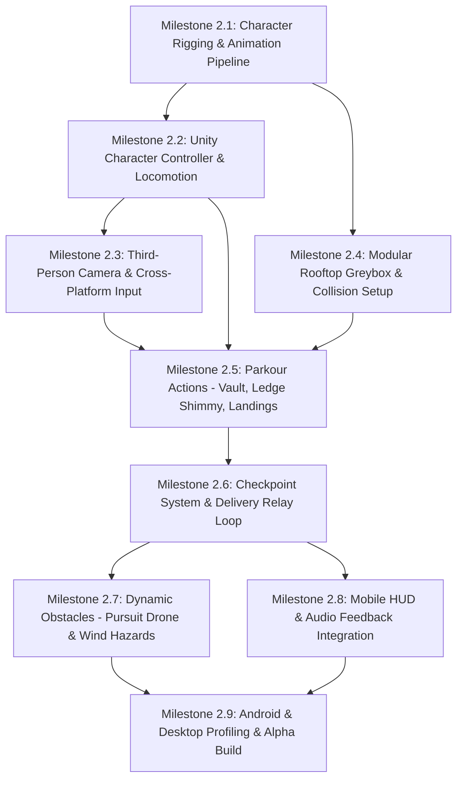

# Roofline Relay — Comprehensive Project Gap Audit & Technical Roadmap

## 1. Executive Summary & Verification Context
This document establishes the verified baseline of **Roofline Relay** as of Milestone 2 completion. It details what is complete, partially complete, missing, broken, unverified, and unnecessary across 14 core project domains. Every claim in this audit is backed by inspection of the active repository code, asset files, and engine settings.

- **Repository Root:** `C:\Users\saipa\OneDrive\Desktop\Roofline Relay`
- **Unity Project:** `C:\Users\saipa\OneDrive\Desktop\Roofline Relay\unity-game\` (Unity 6 `6000.6.7f1`, Universal Render Pipeline)
- **Primary 3D Engine & DCC Tool:** Blender 5.2.2 LTS (installed at `C:\Program Files\Blender Foundation\Blender 5.2\blender.exe`)
- **Target Hardware Constraints:** Laptop with ~8 GB RAM and integrated Intel UHD Graphics
- **Target Deployment:** Android Mobile (Landscape) & Windows Desktop (Standalone x64)
- **Budget Constraint:** ₹0 (strictly free tools, local installations, open-source resources, zero paid APIs/subscriptions)

---

## 2. 14-Domain Project Gap Audit

### 2.1 Character Models, Skeletons, Rigs, and Animations
- **Current Status:** Partially Complete (Static meshes staged; Rigging & Animation Missing).
- **Evidence:** Inspection of all 44 models in `docs/asset-audit/organized-models/` revealed that 5 of 6 humanoids (`courier_female_urban_scout.glb`, `courier_male_recon_pilot_candidate_b.glb`, `courier_male_urban_sentinel_candidate_c.glb`, `relay_operator_tactical_dispatcher.glb`, `rival_runner_urban_trail_sentinel.glb`) are static meshes with 0 bones, 0 skin weights, and 0 animation tracks. Only `courier_male_rigged_candidate_a.glb` possesses a 29-bone armature, but it has severe scale distortion (stands 2.70m tall) and zero animation clips.
- **Dependencies:** Blender 5.2.2 LTS rigging pipeline.
- **Priority:** CRITICAL (Milestone Priority 1).
- **Next Practical Action:** Select `courier_female_urban_scout.glb` (Urban Scout), generate a clean humanoid armature, paint skin weights, verify joint deformations, and build the foundational parkour animation clip set.

### 2.2 Character Appearance, Materials, Textures, and Optimization
- **Current Status:** Partially Complete (Base PBR materials present; optimization needed).
- **Evidence:** `courier_female_urban_scout.glb` contains 1 mesh, 38,165 vertices, and 65,568 triangles with embedded base color and normal maps. While visually sharp, 65k triangles is heavy for mobile background runners, though acceptable for the primary hero character in a first prototype.
- **Dependencies:** Model import pipeline into Unity URP.
- **Priority:** HIGH.
- **Next Practical Action:** Extract embedded textures into `unity-game/Assets/Art/Materials/` and ensure URP Lit shader compatibility with standard mobile texture compression (ASTC / BC7).

### 2.3 Animation Import and Unity Animator Configuration
- **Current Status:** Missing.
- **Evidence:** `unity-game/Assets/` currently has empty folders for animations and controllers. No `.anim` or `.controller` assets exist in the project.
- **Dependencies:** Exported rigged character asset with animation tracks.
- **Priority:** CRITICAL.
- **Next Practical Action:** Configure Unity Humanoid Avatar on the imported character, create `CourierAnimatorController.controller`, set up blend trees for locomotion (Idle, Walk, Run), and configure Boolean/Trigger transitions for Jump, Falling, Landing, and Vaulting.

### 2.4 Player Movement, Running, Jumping, Falling, Landing, and Parkour Mechanics
- **Current Status:** Missing.
- **Evidence:** `unity-game/Assets/Scripts/` contains only `.gitkeep`. No CharacterController, Rigidbody, or parkour state machine script exists yet.
- **Dependencies:** Working Animator Controller and collision environment.
- **Priority:** HIGH (Scheduled immediately after character animation pipeline).
- **Next Practical Action:** Develop a modular C# `PlayerParkourController.cs` utilizing Unity's CharacterController component, implementing momentum preservation, slope handling, jump buffering, coyote time, and vault raycasts.

### 2.5 Camera, Controls, and Input Handling
- **Current Status:** Partially Complete (Input asset exists; Camera controller missing).
- **Evidence:** `unity-game/Assets/InputSystem_Actions.inputactions` is configured with actions for `Move` (Vector2), `Look` (Vector2), `Jump` (Button), `Sprint` (Button), and `Interact` (Button). However, no custom camera script or Cinemachine virtual camera exists in `SampleScene.unity`.
- **Dependencies:** Player GameObject in scene.
- **Priority:** HIGH.
- **Next Practical Action:** Implement a smooth third-person follow camera with collision dampening and landscape touchscreen on-screen sticks / button bindings.

### 2.6 Rooftop Geometry, Modular Level Construction, Colliders, and Routes
- **Current Status:** Partially Complete (Audited models staged; Scene assembly missing).
- **Evidence:** 37 environment modules, parkour obstacles, and architectural pillars exist in `docs/asset-audit/organized-models/environment/` and `props/`. `unity-game/Assets/Scenes/SampleScene.unity` remains an empty template scene.
- **Dependencies:** Verification of character traversal metrics (jump distance, vault height).
- **Priority:** MEDIUM-HIGH.
- **Next Practical Action:** Import the verified 10-piece prototype starter kit (`rooftop_platform_slab_module`, `modular_roof_edge_structure`, `modular_facade_concrete_window_section`, `architectural_corner_pillar_module`, `fixed_metal_caged_service_ladder`, `modular_safety_railing_barrier`, `industrial_catwalk_bridge_module`, `industrial_pipe_vault_obstacle`, `checkpoint_marker_quantum_gate`, `relay_activation_control_console`) and construct a greybox linear test track.

### 2.7 Hazards, Moving Obstacles, Drones, and Gameplay Objects
- **Current Status:** In Staging (Models audited; Behaviors unbuilt).
- **Evidence:** `security_pursuit_drone_sentinel.glb` is audited at 363k triangles without separated rotor hierarchies or AI logic.
- **Dependencies:** Player traversal mechanics and level boundaries.
- **Priority:** MEDIUM.
- **Next Practical Action:** Decimate drone mesh, separate 4 rotors into child nodes for continuous spin scripts, and build simple waypoint patrol and proximity alert behaviors.

### 2.8 Checkpoints, Relay Objectives, Progression, and Fail/Retry Flow
- **Current Status:** In Staging (Static gate and terminal models ready; logic missing).
- **Evidence:** `checkpoint_marker_quantum_gate.glb` and `relay_activation_control_console.glb` exist as static meshes. No mission manager, timer, lap counter, or respawn logic exists in C#.
- **Dependencies:** Player death / out-of-bounds trigger zones.
- **Priority:** MEDIUM.
- **Next Practical Action:** Write `Checkpoint.cs`, `RelayObjective.cs`, and `GameManager.cs` handling run timers, package delivery status, and instant rooftop respawn.

### 2.9 HUD, Menus, Mobile Touch Controls, and Desktop Controls
- **Current Status:** Missing.
- **Evidence:** `unity-game/Assets/UI/` contains `.gitkeep`. Unity UI (`com.unity.ugui 2.6.0`) is installed in packages, but no Canvas, buttons, or speedometers exist.
- **Dependencies:** Input actions and Player state broadcasts.
- **Priority:** MEDIUM.
- **Next Practical Action:** Construct a Canvas with mobile on-screen joystick, Sprint/Jump touch buttons, delivery timer, and speed indicator.

### 2.10 Audio, Sound Effects, Ambience, and Feedback
- **Current Status:** Structure Initialized (Audio folders ready; Audio assets missing).
- **Evidence:** `unity-game/Assets/Audio/Ambience/`, `Music/`, and `SFX/` are created. No `.wav` or `.ogg` sound files exist yet.
- **Dependencies:** Gameplay action events (footsteps, jump, wind whoosh, relay chime).
- **Priority:** LOW-MEDIUM.
- **Next Practical Action:** Source or generate free CC0 rooftop wind ambience, dynamic footstep audio clips, and landing thud effects routed through Unity AudioMixer.

### 2.11 Lighting, Effects, Post-Processing, and Visual Polish
- **Current Status:** Baseline Configured (URP volume profiles present).
- **Evidence:** `unity-game/Assets/Settings/DefaultVolumeProfile.asset` contains Tonemapping (Neutral), Bloom, and Vignette overrides. Directional light and skybox in `SampleScene.unity` are default template settings.
- **Dependencies:** Modular level blockout.
- **Priority:** LOW-MEDIUM.
- **Next Practical Action:** Tune directional sunlight to achieve high-contrast dawn/dusk rooftop shadows and configure mobile-safe Bloom thresholds that do not tank Intel UHD framerates.

### 2.12 Performance, Profiling, Memory Usage, and Android Compatibility
- **Current Status:** Pre-configured (Lightweight URP settings locked).
- **Evidence:** Shadow cascades capped at 2, shadow distance set to 40m, MSAA disabled/1x in `PC_RPAsset.asset` and `Mobile_RPAsset.asset`. ASTC texture compression targeted.
- **Dependencies:** Populated test scenes.
- **Priority:** HIGH (Continuous constraint).
- **Next Practical Action:** Keep total scene draw calls under 150 and total runtime vertex count under 250k for smooth 60 FPS execution on 8 GB RAM / Intel UHD hardware.

### 2.13 Build Configuration for Android and Windows
- **Current Status:** Configured & Verified.
- **Evidence:** Unity Hub confirmed `Android`, `Android SDK & NDK Tools`, and `OpenJDK` modules are installed on Unity `6000.6.7f1`. Orientation locked to landscape in `ProjectSettings.asset`.
- **Dependencies:** Complete playable test slice.
- **Priority:** MEDIUM.
- **Next Practical Action:** Validate clean Windows Standalone build and verify Android APK build pipeline once the first playable blockout is assembled.

### 2.14 Testing, Git Workflow, and Project Documentation
- **Current Status:** Fully Operational.
- **Evidence:** `.gitignore` recursively ignores all Unity caches (`Library/`, `Temp/`, `Logs/`, `UserSettings/`, `Obj/`, `*.slnx`). `GIT_WORKFLOW.md` and `AGENTS.md` strictly enforced. Clean commit history on `main` tracked without unauthorized pushes.
- **Dependencies:** Continuous execution.
- **Priority:** CRITICAL.
- **Next Practical Action:** Maintain atomic local commits after each verified task.

---

## 3. Master Dependency-Ordered Roadmap

### Stage Execution Sequence
1. **Stage 1 (Current Immediate Priority):** Rig the Urban Scout character in Blender, skin to a clean humanoid armature, generate the 9 foundational parkour animation clips, and import into Unity with an Animator Controller.
2. **Stage 2:** Implement `PlayerParkourController.cs` linking user input to the animator and CharacterController.
3. **Stage 3:** Import the 10-piece modular environment starter kit and construct the initial rooftop test strip.
4. **Stage 4:** Integrate follow-camera, landing impact checks, and obstacle vault triggers.
5. **Stage 5:** Implement checkpoint quantum gates, package delivery objective, HUD timer, and audio cues.
6. **Stage 6:** Build standalone test executables for Windows and Android.
